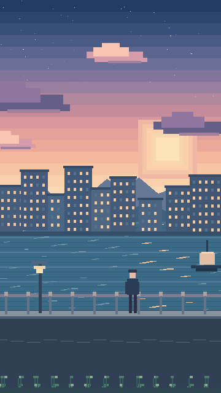

# Pixel Videos — Cinematic Pixel-Art Animation Studio



**Agent-friendly, code-driven 2D / 2.5D / 3D pixel-art filmmaking.**

Build towards beautiful painterly pixel-art scenery with animated weather, moving characters, reflective water, parallax and deliberate cinematic cameras. The look is **handcrafted environmental pixel art**, *not* a low-poly world with a pixelation filter.

## Included

- **Remotion**: 2D React animation timeline, frame-exact compositions and video rendering.
- **PixiJS**: 2D sprite / parallax / particle rendering library, declared as an npm dependency for future scene modules.
- **FFmpeg**: faithful integer nearest-neighbour upscale from 360×640 to 1080×1920, audio finishing.
- **Original `SunsetHarbor` scene**: 8 seconds, 30fps, moving clouds, rippling harbour, background buildings, a passing boat, foreground plants and tiny character.
- **Standalone offline demo renderer**: Pillow + FFmpeg alternative for testing the art direction even when npm / Chromium is unavailable; generates a genuine playable 6-second MP4.
- **GitHub Actions video job**: render + verify + upload final MP4 as workflow artifact.
- **Optional full-tool downloader**: Godot, Pixelorama, Parallax Scene Editor, pixelgen.

All source materials in this starter are newly written. External projects are downloaded into `.tools/` on demand, not copied into your repository, so each upstream license remains separate.

## Quick start

Requirements: Node 22+, npm, Python 3.10+, FFmpeg. Pillow for the optional offline renderer. A browser for Remotion Studio.

```bash
npm install
npm run studio
# Remotion Studio: select SunsetHarbor to inspect the timeline
npm run render
# final: out/sunset-harbor-1080p.mp4
```

To test an original playable video without any JavaScript dependencies:

```bash
python3 -m pip install -r requirements-demo.txt
npm run demo:offline
# preview: out/sunset-harbor-offline.mp4
```

For the optional editing + 3D toolchain:

```bash
python3 scripts/install_tools.py --all
# Or choose --pixelorama, --godot, --parallax, --pixelgen individually
npm run check
```

**Note:** `--all` requires internet and downloads large binaries; Godot and Pixelorama are standalone programs, *not* npm packages. Rust/Cargo is necessary to compile pixelgen. The installer chooses supported release archives and reports unsupported platforms. It does not silently install operating-system dependencies.

## NightDrive (recreated lyric clip)

A 17.5 s, 180×320 → 1080×1920 pixel-art night drive: static street scene, two animated passengers and word-by-word lyric captions with a decaying wobble. The backdrop and passenger frames are traced from a reference clip into `src/scenes/nightDriveData.ts`; the 7×7 caption font lives in `src/scenes/pixelFont.ts`.

```bash
npm run render:night-drive -- --audio reference.mp4   # audio optional
python3 tools/extract_night_drive.py reference.mp4    # regenerate the traced data
```

## Rendering model

The project renders actual frames at **360×640**, then scales to **1080×1920** using nearest-neighbour interpolation. This is cheaper for many 2D scenes than physically rendering every output pixel. Compression and 3D shader cost still matter. The default demo uses original procedural pixel art and true frame-by-frame motion.

- `src/index.ts` — Remotion entry point
- `src/Root.tsx` — compositions
- `src/scenes/SunsetHarbor.tsx` — original animated pixel-art film
- `scripts/render.mjs` — Remotion render + FFmpeg integer upscale
- `scripts/render_demo.py` — standalone preview generator
- `scripts/install_tools.py` — optional tool downloader
- `docs/AGENT_GUIDE.md` — assignment contract and QA
- `docs/STYLE_GUIDE.md` — art direction

## External project sources

| Tool | Role | Upstream |
| --- | --- | --- |
| Remotion | React timeline and MP4 production | https://www.remotion.dev/ |
| PixiJS | 2D scene renderer / WebGL sprites | https://github.com/pixijs/pixijs |
| Pixelorama | Pixel art drawing / spritesheet animation | https://github.com/Orama-Interactive/Pixelorama |
| Godot | 2D/3D pixel-art scenes and camera animation | https://github.com/godotengine/godot |
| Parallax Scene Editor | Layered looping scenery and PNG sequence exports | https://github.com/christt105/parallax-scene-editor |
| pixelgen | Pixel-art stills and seamless environmental loops | https://github.com/jmelahman/pixelgen |
| FFmpeg | Video finishing and encode verification | https://ffmpeg.org/ |

**Licensing:** this repository's new scaffolding is MIT; it does **not** relicense third-party libraries or editors. Remotion has separate terms that may require a company license for some uses. Confirm compatibility and provenance of any imported models, sprite artwork or music before publishing.

## Adding 3D scenes

Build a Godot scene with orthographic cameras, small palettes, pixel-snapped sprites, low internal resolution, simple silhouettes and carefully authored shaders. Use Godot Movie Maker to export PNG frames, then assemble them in FFmpeg/Remotion. This keeps the 3D engine independent of the video timeline.

## How to publish this as a new GitHub repository

1. Create a **new empty** GitHub repository named `pixel-videos` under your own account. Private is recommended during development. Do not generate a README, licence or .gitignore in GitHub because they are already included here.
2. Extract the ZIP and use your Git client in the extracted folder:

```bash
git init -b main
git add .
git commit -m "Initial Pixel Videos studio"
git remote add origin https://github.com/YunRah2103/pixel-videos.git
git push -u origin main
```

Or upload the project files using the GitHub web interface. Do **not** upload `.tools`, `node_modules` or the generated `out` folder. `npm install` and `--all` perform actual downloads on the user's machine or CI runner; tools are not bundled inside the ZIP.
