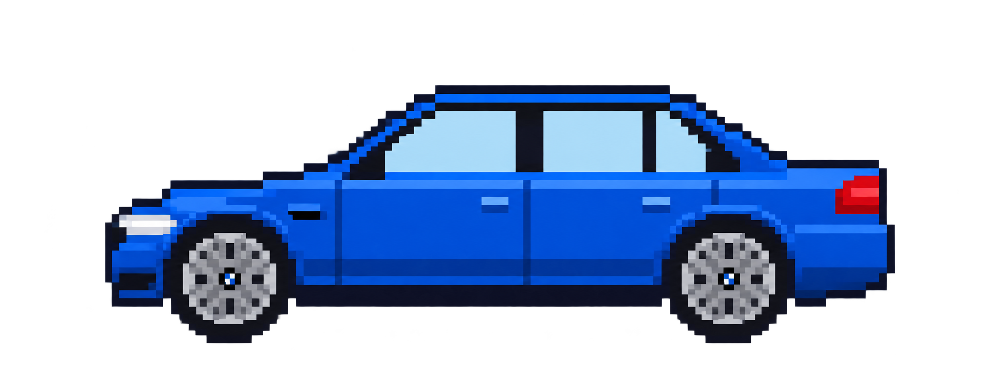

# Blue BMW M3 E90 explainer sprite

Left-facing static 2D side-view sprite, remade in the simple chunky pixel style of the user's supplied explainer video, 198163.mp4. Transparent RGBA PNG, 2048 x 768.

Generated with OpenAI image generation on 2026-10-27 using a contact sheet from the supplied video as a style reference. Stylised interpretation rather than an exact technical vehicle drawing. BMW names and design belong to their respective owners; no affiliation is implied.

Use Remotion staticFile('sprites/bmw-m3-e90/bmw-m3-e90-blue-side.png'). Preserve aspect ratio. Wheels are baked into this static sprite and need separate layers for independent rotation.
